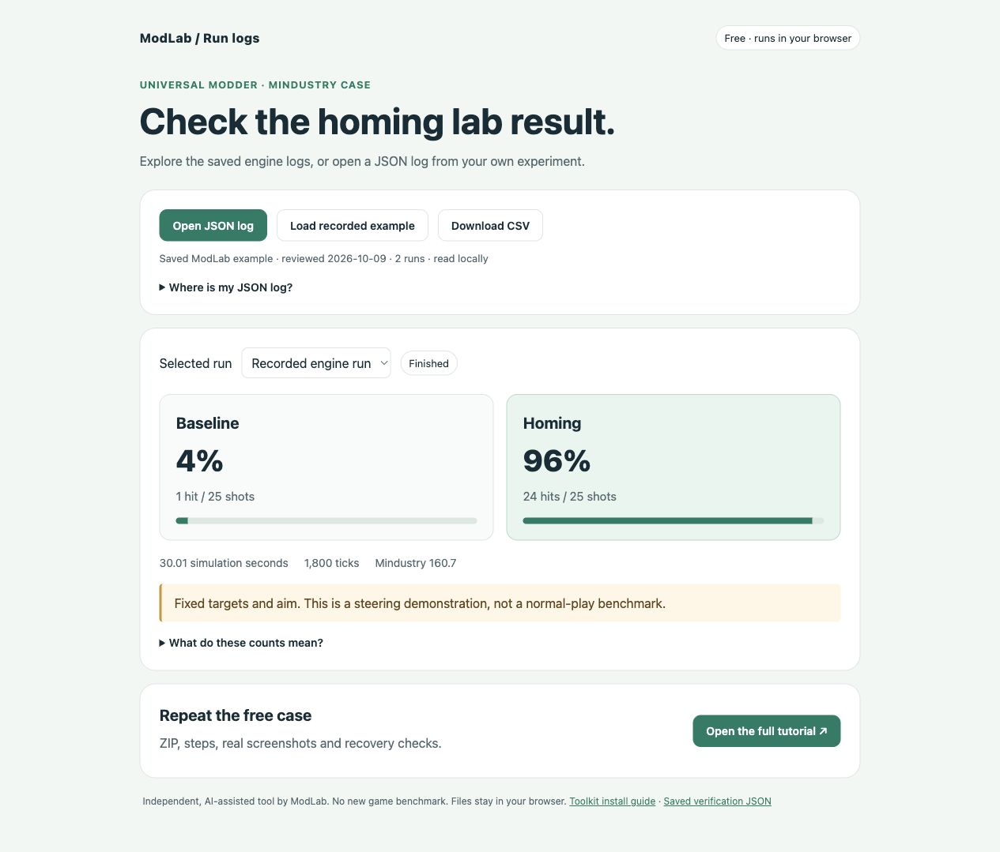

# Universal Modder Run Log Viewer

A free, independent browser companion for the Mindustry homing lab. Inspect a saved JSON log, compare the two lanes, preview CSV and export the selected run.

[Open the live viewer](https://modlabguides.online/tools/universal-modder-run-log-viewer) · [Reproduce the free Mindustry example](https://modlabguides.online/workshop/mindustry-homing)



## Run the standalone app

Serve this directory with a static HTTP server. For example, with Python 3:

```sh
python3 -m http.server 8000 --bind 127.0.0.1
```

Open `http://127.0.0.1:8000`. No build step, package installation, account or inference API is needed. HTTP is used to load the included sample; opening `index.html` directly as a file may block that request. Once the app is loaded, selected JSON file contents are processed locally. This standalone source has no upload endpoint, analytics, external script or external font.

The live ModLab website has its own privacy policy. The screenshot shows its companion interface; the standalone interface is included in `index.html`.

## Included evidence

`sample-data.json` contains two previously recorded runs, reviewed on October 9, 2026:

| Environment | Recorded result |
| --- | --- |
| Mindustry 160.7, mod 0.1.0, macOS 15.7, Apple M1 Max, official x86_64 app under Rosetta | Baseline: 1 hit / 25 shots; homing: 24 hits / 25 shots |
| Same environment after installing the ZIP in a restored clean profile | Baseline: 1 hit / 25 shots; homing: 24 hits / 25 shots |

Each run lasted approximately 1,800 simulation ticks, or 30 simulation seconds. Targets and aim were scripted, with no splash damage. These are steering demonstrations, not normal-play benchmarks. Publishing this source does not constitute a new game run. Windows, Linux, multiplayer and independent learner reproduction remain unverified.

## Log format and checks

- Open either a single run object or the supplied bundle containing `recordedRun` and `cleanZipRun`.
- Index 0 in `shots` and `hits` is the baseline lane; index 1 is the homing lane.
- Shots come from turret `totalShots`; hits come from `UnitDamageEvent` for the lane's designated target.
- The parser checks count types and ranges, hits not exceeding shots, finite non-negative timing, timing consistency and the `finished` flag.
- Zero shots have no hit percentage. An incomplete run remains marked incomplete.
- CSV contains only the currently selected run. The viewer does not authenticate the origin of an uploaded log.
- View CSV shows the same selected-run data directly on the page. Select CSV text lets you copy it with your browser's normal copy command when downloads are unavailable in an embedded browser. The preview updates when the selected run changes and clears when a log is rejected.

The [draft-07 single-run JSON schema](schema/modlab-mindustry-run-log-v1.schema.json) is for editors and scripts. It describes the raw `modlab-last-run.json` object, not the complete two-run bundle. The viewer uses its own parser; cross-field count and timing relationships are checked by that parser, rather than by the schema.

## Source and license

This standalone implementation started with the original [Hugging Face Space](https://huggingface.co/spaces/liuminsheng3/universal-modder-run-log-viewer). Commit `f389ccc` preserves that initial implementation. The current HTML and JavaScript add a selected-run CSV preview for embedded browsers; the recorded sample data and parser rules are unchanged. Older published ZIPs remain separate releases.

ModLab maintains this project with AI assistance. It is independent of the [Universal Modder](https://github.com/rehan-remade/universal-modder) and [Mindustry](https://github.com/Anuken/Mindustry) maintainers. The source, authored sample metadata and schema use the MIT license. No game executable, game assets or private website template source is included. The game retains its own license.
